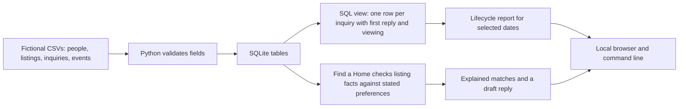

# Lead Lifecycle & Rental Facilitator

A Python and SQLite portfolio demo for two questions. How many people asked about a rental listing, and what happened to their inquiries? Given a budget, room count, move-in date, and optional feature, which listings meet those preferences?

The lifecycle report counts people and inquiries separately. **Find a Home** explains each listing match and prepares a sample reply for review. All records were invented for this demo. Samuel Vanegas defined the project scope and synthetic data requirements. Codex implemented the pipeline, browser interface, and tests.

## Pipeline diagram



## Run locally

Use Python 3.11 or newer. SQLite and the HTTP server come with standard Python installations. The demo requires no extra packages or accounts. Run these commands from the repository folder.

```powershell
python -m unittest -v
python lead_demo.py report --start 2030-05-01 --end 2030-05-31
python lead_demo.py find --max-rent 1600 --min-bedrooms 2 --available-by 2030-05-15
python serve.py
```

Open **http://127.0.0.1:4180/** and use **Ctrl+C** in the terminal to stop the server. The server listens only on your computer. SQLite loads the CSVs into memory. Use fictional search criteria because form values appear in the browser URL.

## Data and reporting rules

| Input | One row represents | IDs and relationships |
| --- | --- | --- |
| `demo/people.csv` | One fictional person with a generated label | `person_id` |
| `demo/listings.csv` | One fictional rental listing | `listing_id` |
| `demo/leads.csv` | One person's inquiry about one listing | Unique `lead_id`, linked by `person_id` and `listing_id` |
| `demo/events.csv` | One recorded reply or viewing | Unique `event_id`, linked by `lead_id` |

The checked-in dataset contains **120 fictional people, 13 listings, 148 inquiries, and 242 events**. The people have generated labels such as `Demo Person 001`. The generator uses a fixed random seed and no external data. Run `python generate_demo.py` to recreate and replace all four CSVs.

The report includes inquiries received from the selected start date through the end date, inclusive. The SQL view keeps one row per inquiry and retains the earliest date of each milestone. The report counts an inquiry toward a milestone only if its first event of that type occurred by the end date. A person who asks about two listings counts once in the overall people total. Both inquiries are counted, and the person appears in both listing subtotals. Listings with no inquiries stay visible.

## Verified example

| May 1 to 31, 2030 | Total |
| --- | ---: |
| Distinct people | 120 |
| Inquiries received | 144 |
| Inquiries with a recorded reply by May 31 | 130 |
| Inquiries with a recorded viewing by May 31 | 57 |

A separate calculation over the CSVs checks the totals and each listing's counts against SQL. The tests also cover reproducible fixtures, date boundaries, repeat milestones, invalid and unmatched records, listing filters, missing dates, and form validation.

The search command above returns **Demo Alderfold Corner Flat** and **Demo Cloudmere Courtyard**. One other listing meets the budget and room count but has an unknown availability date. The search reports that exclusion when a deadline is selected. Without a deadline, otherwise matching listings with unknown dates can appear. Matches are sorted by monthly rent and then listing ID.

## Scope and limitations

The report describes records within the selected dates. A reply record does not establish successful contact, and a viewing does not establish a rental outcome. The catalog is fictional. Find a Home compares property attributes with manually entered preferences. It has no applicant screening, call recordings, live inventory, or message delivery. The sample reply is plain text for review.
